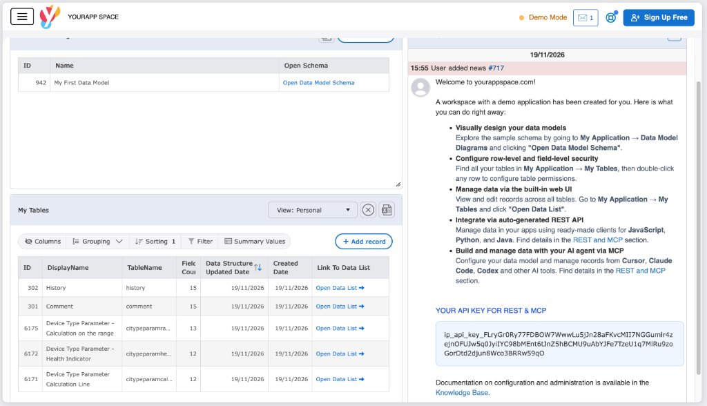

# YourAppSpace MCP Server

**Give AI coding agents (Claude Code, Cursor, OpenAI Codex CLI, JetBrains AI Assistant) a structured backend with a built-in Visual Schema Designer, Data Grid UI, auto-generated REST APIs, and Row/Field-Level Security (RLS & FLS).**

[](https://core.yourappspace.com)
[](https://yourappspace.com/docs.html)
[](https://youtu.be/1x-sCBesZVo)
[](./LICENSE)

---

## Why YourAppSpace MCP?

Most database MCP servers give an LLM raw SQL access to a database—risking destructive schema changes, leaking restricted columns, and leaving you with no UI to inspect or manage the data.

**YourAppSpace Core** solves this by pairing an **AI-ready Entity MCP** with a **Visual Data Platform**:

- **Visual Schema + Data Grid UI:** Everything your AI agent creates via MCP (`create_table`, `add_field`, `create_rows`) immediately appears in a live visual schema designer and spreadsheet-like Data Grid UI with filtering and Excel/CSV export.
- **Safe by Design (RLS & FLS):** Agents operate through the platform's Entity API governed by **Row-Level Security** and **Field-Level Security** instead of raw SQL—no accidental `DROP TABLE` or unauthorized field reads.
- **Instant REST APIs:** Every table modeled by your agent automatically exposes documented REST endpoints.
- **Zero Vendor Lock-in:** Run on YourAppSpace Cloud (`https://core.yourappspace.com`) or deploy on-premise via Docker.

> **Hosted Remote MCP (Zero-Install) — Coming Soon:**
> In the next release of YourAppSpace Core, you will be able to connect directly to a **Hosted Remote MCP endpoint (Streamable HTTP)** straight from your workspace URL—requiring **zero local installation, no Node.js, and no local processes**.
> Until then (and for local Docker / air-gapped on-premise deployments), use this lightweight open-source **STDIO connector**.

---

## Prerequisites

- **Node.js** `>= 20.20` and **npm** `>= 10.8`
- A **YourAppSpace Core** account or instant demo workspace:
  1. Open [core.yourappspace.com](https://core.yourappspace.com) and click **Try now** (no sign-up required) or sign in to your workspace.
  2. Immediately after signing in, open the welcome message on the right panel and copy your **API Key** (`ip_api_key_...`) from the **YOUR API KEY FOR REST & MCP** section:



---

## Quick Start (Local STDIO Connector)

1. **Clone the repository and install dependencies:**
   ```bash
   git clone https://github.com/yourappspace/yourappspace-mcp.git
   cd yourappspace-mcp
   npm install
   ```

2. **Connect your AI client** using `MCP_ENTITY_BASE_URL` and `MCP_ENTITY_API_KEY` (recommended), as shown below.

---

## Client Configuration

Replace `<path_to_repo>` with the absolute path to `yourappspace-mcp` and `<api-key>` with your full `ip_api_key_...` value.

### 1. Claude Code (`.mcp.json`)

Create or update `.mcp.json` in your project root:

```json
{
  "mcpServers": {
    "dev-entity": {
      "command": "node",
      "args": ["<path_to_repo>/server.js"],
      "env": {
        "MCP_ENTITY_BASE_URL": "https://core.yourappspace.com",
        "MCP_ENTITY_API_KEY": "<api-key>"
      }
    }
  }
}
```

Verify active tools inside Claude Code by running `/mcp`.

### 2. Cursor (`.cursor/mcp.json`)

Add to `.cursor/mcp.json` in your project or global `~/.cursor/mcp.json`:

```json
{
  "mcpServers": {
    "dev-entity": {
      "command": "node",
      "args": ["<path_to_repo>/server.js"],
      "env": {
        "MCP_ENTITY_BASE_URL": "https://core.yourappspace.com",
        "MCP_ENTITY_API_KEY": "<api-key>"
      }
    }
  }
}
```

### 3. OpenAI Codex CLI (`~/.codex/config.toml`)

```toml
[mcp_servers.dev-entity]
command = "node"
args = ["<path_to_repo>/server.js"]

[mcp_servers.dev-entity.env]
MCP_ENTITY_BASE_URL = "https://core.yourappspace.com"
MCP_ENTITY_API_KEY = "<api-key>"
```

### 4. JetBrains IntelliJ IDEA AI Assistant

1. Open **Settings → Tools → AI Assistant → Model Context Protocol (MCP)**.
2. Click **+ Add** and select **STDIO**.
3. Paste the JSON configuration above (same format as Claude Code / Cursor) and click **Apply**.

---

## Authentication & Environment Variables

| Variable | Description | Example |
| --- | --- | --- |
| `MCP_ENTITY_BASE_URL` | Full base URL of your YourAppSpace instance (SaaS or Docker; default: `http://localhost:8080`) | `https://core.yourappspace.com` |
| `MCP_ENTITY_API_KEY` | Full user API key with the `ip_api_key_` prefix (without `Bearer`). Sent in the `X-Auth` header. | `ip_api_key_FLryGr0Ry...` |
| `MCP_ENTITY_USER` | *(Optional fallback)* Email / username used only if `MCP_ENTITY_API_KEY` is omitted or blank | `demo_manager@yourappspace.com` |
| `MCP_ENTITY_PASSWORD` | *(Optional fallback)* Account password used only if `MCP_ENTITY_API_KEY` is omitted or blank | `••••••••` |

### Important Authentication Notes

- **API Key priority:** A non-empty `MCP_ENTITY_API_KEY` takes priority over `MCP_ENTITY_USER` and `MCP_ENTITY_PASSWORD` and is sent directly in the `X-Auth` header. If API key authentication fails, the server **does not** fall back to username and password.
- **Permissions:** Requests execute under the permissions of the API key owner (or signed-in user), enforcing table and record access maps (RLS & FLS).
- **Verifying the connection:** Viewing the tool list does not verify authentication. After saving or changing `MCP_ENTITY_API_KEY` or `MCP_ENTITY_BASE_URL`, restart your MCP client and call `list_tables` with `{"offset": 0, "limit": 1}`.
  - On **HTTP `401`**: check the key value (including the `ip_api_key_` prefix), its expiration date, its owner, and API key support on the target instance.
  - On **HTTP `403`**: verify the user's permissions for the requested table or operation.

---

## Available MCP Tools (8 Tools)

| Tool | Purpose | Modifies Data |
| --- | --- | --- |
| `list_tables` | Lists accessible tables across user and system spaces | No |
| `get_table` | Retrieves table metadata, column types, and schema definition | No |
| `create_table` | Creates a new custom table in the active workspace | Yes |
| `add_field` | Adds a data column (`INTEGER`, `STRING`, `TEXT`, `combobox`, etc.) or lookup relationship | Yes |
| `read_rows` | Queries records with `WHERE` / JSON filters, ordering, and pagination | No |
| `create_rows` | Inserts one or multiple records in batch mode | Yes |
| `update_rows` | Updates one or multiple records by primary key | Yes |
| `delete_rows` | Deletes one or multiple records by primary key | Yes |

---

## System Prompt for AI Agents (`BASE_PROMPT.md`)

This repository includes [`BASE_PROMPT.md`](./BASE_PROMPT.md), which gives AI agents full knowledge of YourAppSpace core data types, field widgets (`combobox`, `lookup`, etc.), and schema conventions:

- **Claude Code:** Copy [`BASE_PROMPT.md`](./BASE_PROMPT.md) to `CLAUDE.md` in your project root.
- **Codex CLI:** Copy [`BASE_PROMPT.md`](./BASE_PROMPT.md) to `AGENTS.md` in your project root.
- **IntelliJ AI Assistant:** Add it to **Settings → Tools → AI Assistant → Prompt Library**.

---

## Examples: Prompt & Result

Below is a complete end-to-end workflow inspired by our [YouTube walkthrough](https://youtu.be/1x-sCBesZVo), showing how an AI agent creates a table with multiple field types, populates records, and runs filtered + aggregated queries.

### 1. Create a Table with Multiple Field Types (Text, Numeric, Combobox, Reference)

**Prompt:**
> Create a new table called `Customer Feedback` (`customer_feedback`) with 4 fields:
> 1. `comment` — multi-line text for the customer's review
> 2. `rating` — integer score from 1 to 5
> 3. `status` — combobox enumeration with values `New`, `Reviewed`, and `Resolved`
> 4. `order_id` — lookup reference linking to the existing `Order` (`order`) table

**Result:**
The agent invokes `create_table` followed by `add_field` for each column and confirms the live schema:

```text
Created table "Customer Feedback" (system name: customer_feedback, id: 6204)

Fields added:
- comment   | TEXT     | widget: textarea | Label: "Comment"
- rating    | INTEGER  | widget: number   | Label: "Rating"
- status    | STRING   | widget: combobox | Values: ["New", "Reviewed", "Resolved"]
- order_id  | BIGINT   | widget: lookup   | Reference: order (Order)

You can now inspect the schema in Data Model Designer or open the Data Grid at My Application -> My Tables -> customer_feedback.
```

---

### 2. Insert Records into the New Table

**Prompt:**
> Add 4 sample feedback records into `customer_feedback` linked to existing orders:
> - Order 1: rating 5, status `Reviewed`, comment `"Fast delivery and great packaging"`
> - Order 2: rating 4, status `New`, comment `"Good quality, minor delay on shipping"`
> - Order 3: rating 2, status `New`, comment `"Missing instruction manual in the box"`
> - Order 6: rating 5, status `Resolved`, comment `"Discount applied smoothly, will order again"`

**Result:**
The agent calls `read_rows` on `order` to verify valid order IDs, then executes `create_rows` in batch mode on `customer_feedback`:

```text
Inserted 4 records into customer_feedback:

| id  | order_id       | rating | status   | comment                                       |
| --- | -------------- | ------ | -------- | --------------------------------------------- |
| 101 | Order 1 (id:1) | 5      | Reviewed | Fast delivery and great packaging             |
| 102 | Order 2 (id:2) | 4      | New      | Good quality, minor delay on shipping         |
| 103 | Order 3 (id:3) | 2      | New      | Missing instruction manual in the box         |
| 104 | Order 6 (id:6) | 5      | Resolved | Discount applied smoothly, will order again   |
```

---

### 3. Query with Filtering and Aggregation

**Prompt:**
> Query `customer_feedback` for all records where `rating >= 4`, show the matching rows, and calculate the total matching count, average rating, and breakdown by `status`.

**Result:**
The agent calls `read_rows` with a filter (`rating >= 4`) and aggregates the returned dataset:

```text
Filtered records from customer_feedback (rating >= 4):

| id  | order_id | rating | status   | comment                                     |
| --- | -------- | ------ | -------- | ------------------------------------------- |
| 101 | 1        | 5      | Reviewed | Fast delivery and great packaging           |
| 102 | 2        | 4      | New      | Good quality, minor delay on shipping       |
| 104 | 6        | 5      | Resolved | Discount applied smoothly, will order again |

Summary & Aggregation (rating >= 4):
- Matching records: 3 of 4 total
- Average rating:   4.67
- Breakdown by status:
  - New:      1
  - Reviewed: 1
  - Resolved: 1
```

---

## Resources

- **Live Sandbox (No Sign-Up Required):** [core.yourappspace.com](https://core.yourappspace.com)
- **Video Walkthrough:** [YouTube — YourAppSpace MCP Server Tutorial](https://youtu.be/1x-sCBesZVo)
- **Full Documentation:** [yourappspace.com/docs.html](https://yourappspace.com/docs.html)

---

## License

[MIT](./LICENSE)
